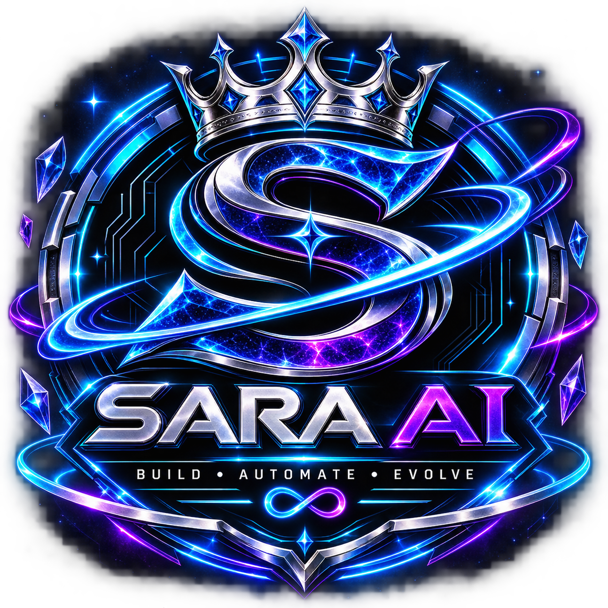
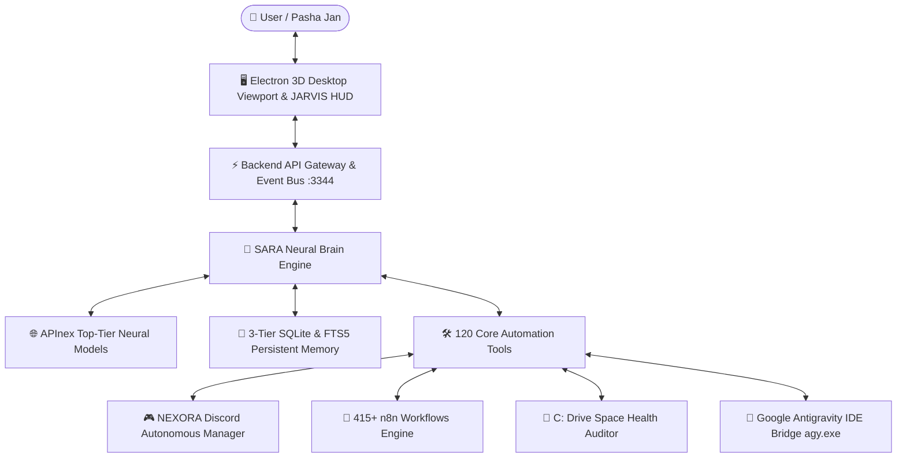

# 🌌 SARA AI 2.5 Pro — Neural Living Companion & Autonomous Engineering Copilot

<p align="center">
  
</p>

<p align="center">
  
  
  
  
  
  
</p>

---

## 🌟 Executive Overview

**SARA AI 2.5 Pro** (*Synthetic Autonomous Reasoning Avatar*) is a next-generation desktop AI companion and autonomous software engineer. Combining an interactive **Three.js 3D living avatar** with procedural viseme lip-sync, an advanced **APInex Multi-Model Neural Brain**, an autonomous **Discord Community Operator** locked strictly to authorized servers, and a massive library of **415+ production n8n automations**, SARA automates Windows, web workflows, coding tasks, and community management.

---

## 🚀 Key Architectural Pillars



### 1. 🌸 3D Live Avatar & Audio-Reactive Lip-Sync
- **Interactive Three.js Viewport**: Real-time rendering of Evelyn PMX / GLB 3D model with customized holographic shader room background.
- **Web Audio FFT (60 FPS)**: High-resolution frequency analysis extracting real-time phonemes (`v_aa`, `v_ih`, `v_ou`, `v_ee`, `v_oh`) for natural lip-sync.
- **Bi-Directional Voice Stream**: Sub-250ms voice latency with intelligent barge-in interruption detection.

### 2. ⚡ Live-Benchmarked APInex Multi-Model Routing
Benchmarked across 26 candidate models with automated failover:
- **Fast Chat**: `free/glm-5.3-flashx` (*1,216ms latency*) — instantaneous witty banter and daily conversation.
- **Urdu & Multimodal Knowledge**: `free/gemini-3.8-flash` (*1,320ms latency*) — expressive Urdu nuance and cultural context.
- **Deep Logic & Architecture**: `free/deepseek-v4-pro-0813` (*1,369ms latency*) — structural programming and system design.
- **Long-Context Research**: `free/kimi-k3` (*1,750ms latency*) — 1M token document audit and codebase comprehension.
- **Syntax Generation**: `free/deepseek-v4.1-flash` (*2,060ms latency*) — clean Python, TypeScript, and Node.js code synthesis.

### 3. 🛡️ Autonomous Discord Community Manager (`NEXORA`)
- **Server Whitelist Guard**: Pinned strictly to authorized server **`NEXORA`**; any foreign server interaction is blocked.
- **8 Categories & 48+ Channels Mapped**: Full awareness of Voice Channels (`General VC`, `-study-room`, `Coding VC`), Development (`-python`, `-ai-ml`, `-backend`, `-frontend`), Community (`-general-chat`, `-daily-wins`), and Learning Hub.
- **Win32 Thread Input Trick**: Reliable foreground window activation bypassing Windows foreground lock timeout restrictions.
- **Autonomous Engagement**: Broadcasts daily developer tips, motivational wins, and coding challenges without manual interaction.

#### 🗺️ NEXORA Server Channel Architecture Matrix
| Category | Type | Mapped Channels |
| :--- | :--- | :--- |
| **VOICE CHANNELS** | Voice / Stage | `General VC`, `-study-room`, `Coding VC`, `Pair Programming`, `Events Stage` |
| **INFORMATION** | Text / Rules | `-rules`, `-announcements`, `-introductions`, `-server-goals` |
| **COMMUNITY** | Text / Social | `-general-chat`, `-random-chat`, `-daily-wins`, `-help-and-support` |
| **DEVELOPMENT** | Text / Code | `-python`, `-java`, `-javascript`, `-typescript`, `-react`, `-nodejs`, `-web-development`, `-app-development`, `-ai-ml`, `-data-science`, `-database`, `-backend`, `-frontend`, `-devops`, `-linux`, `-cybersecurity`, `-game-development`, `-c-language`, `-cpp`, `-csharp`, `-swift-ios`, `-android-development`, `-cloud-computing`, `-api-development`, `-testing-qa`, `-tools-and-tech` |
| **PROJECTS** | Text / Showcase | `-project-showcase`, `-portfolio-review`, `-open-source`, `-build-in-public` |
| **COLLABORATION** | Text / Team | `-find-teammates`, `-freelancing`, `-hackathons`, `-looking-for-help` |
| **LEARNING HUB** | Text / Resources | `-study-resources`, `-learning-roadmaps`, `-coding-challenges`, `-interview-prep`, `-certifications`, `-ask-a-mentor` |
| **CAREERS** | Text / Jobs | `-job-opportunities`, `-remote-jobs`, `-internships`, `-resume-review`, `-mock-interviews`, `-freelancing-tips` |

### 4. 🔄 415+ Integrated n8n Automation Workflows
Indexed from [`repositories/awesome-n8n-templates`](repositories/awesome-n8n-templates) across 25 production categories:
- **AI & RAG Agents**: LangChain agents, Vector store retrieval, OpenAI function calling.
- **Communication & Social**: Automated WhatsApp messaging, Discord notifications, Telegram bots, Slack alerts.
- **Data & Productivity**: Google Sheets sync, Gmail parsing, CRM lead management, Notion pipelines.
- **DevOps & Microservices**: GitHub commit webhooks, server health monitors, Docker deploy hooks.
- **Full Catalog Index**: See [`auto.txt`](auto.txt) (4,800+ lines) and [`automations_report.txt`](automations_report.txt) (3,600+ lines).

### 5. 🛠️ 120 Core Tools Live-Tested Suite
- **System Telemetry**: Real-time CPU, RAM, GPU fallback, battery, and temperature telemetry.
- **Educational Canvas**: Automated MS Paint concept visualization for interactive learning.
- **Browser Organic Operator**: Bing `b_algo` parser with base64 direct URL decoding to bypass bot CAPTCHAs.
- **C: Drive Space Reclamation**: Scans 8 safe expendable cache locations and recovers cleanable gigabytes on confirmation.

### 6. 🧠 3-Tier Persistent SQLite + FTS5 Long-Term Memory
- **L0 Context**: In-memory working buffer for multi-turn dialogue.
- **L1 Facts**: Key-value semantic facts with automated deduplication.
- **L2 Milestones & FTS5**: Full-text search over episodic conversations and project milestones.
- **`synthesize_user_profile()`**: Instant context injection capturing verified identity, contacts, authorized servers, and active projects.
- **`backup_memory()`**: Automated database snapshotting to `data/backups/`.

---

## 🧪 Testing & Verification

SARA AI 2.5 Pro enforces strict Test-Driven Development (TDD) with **244 passing unit tests**:

```bash
python -m unittest discover -s tests -p "test_*.py"
```

```text
Ran 244 tests in 100.419s

OK (0 failures, 0 errors)
[Tools Audit] Report written to: D:\MARAA AI\tools_test_live_report.txt (120 tools verified)
```

---

## 📦 Quickstart & Installation

### Prerequisites
- **Python**: 3.12+ (tested up to 3.14)
- **Node.js**: v18+ or v20+
- **OS**: Windows 10/11 (with Win32 User32 API access)

### Setup Instructions

1. **Clone the Repository**:
   ```bash
   git clone https://github.com/pasha804/SARA-AI-2.5-Pro.git
   cd SARA-AI-2.5-Pro
   ```

2. **Configure Environment Variables**:
   ```bash
   cp .env.example .env
   ```
   Open `.env` and fill in your Gemini API key or APInex key.

3. **Install Python Dependencies**:
   ```bash
   pip install -r requirements.txt  # or install pyautogui pyperclip beautifulsoup4 psutil
   ```

4. **Install Electron Dependencies**:
   ```bash
   cd SARA/resources/app
   npm install
   ```

5. **Launch SARA AI 2.5 Pro**:
   ```bash
   # From root directory:
   launch_sara.bat
   # Or run via node:
   node SARA/resources/app/dist/server.cjs
   ```

---

## ❓ Troubleshooting & Frequently Asked Questions (FAQ)

### Q: Why does Discord automation require Win32 foreground activation?
**A:** On Windows 10/11, OS-level foreground lock timeouts prevent background applications from stealing focus. SARA implements the Win32 `AttachThreadInput` + `SetForegroundWindow` API technique, seamlessly focusing the official Discord desktop client before executing channel quick-switching hotkeys (`Ctrl + K`).

### Q: How does SARA guarantee Discord server isolation?
**A:** SARA's `DiscordCommunityManager` contains a strict security whitelist: `AUTHORIZED_SERVER = "NEXORA"`. If the active Discord window title or quick-switcher context does not match `NEXORA`, navigation and message-posting commands are immediately aborted with an alert.

### Q: What should I do if APInex returns HTTP 429 (Rate Limit)?
**A:** The free APInex tier enforces a 15 RPM limit. SARA features automatic failover and request spacing. If 429 occurs, SARA automatically falls back to secondary models (`free/gemini-3.8-flash`, `free/deepseek-v4-pro-0813`, or local Gemini API).

### Q: How does the C: Drive Space Reclamation pipeline work safely?
**A:** SARA never performs silent deletions on system drives. It scans 8 strictly defined expendable temporary caches (`%TEMP%`, CrashDumps, browser shader caches), calculates exact reclaimable bytes, and requires explicit confirmation before executing unlinks.

---

## 📄 Documentation Manifest

- [`architecture.md`](architecture.md) — Comprehensive technical architecture specification and dataflows.
- [`detailed.txt`](detailed.txt) — 2,000+ line technical reference manual and subsystem index.
- [`auto.txt`](auto.txt) — 4,800+ line itemized breakdown of all 415 n8n automations.
- [`automations_report.txt`](automations_report.txt) — 3,600+ line audit of all workflow templates.
- [`tools_test_live_report.txt`](tools_test_live_report.txt) — Audit report of all 120 core tools.

---

## 👨‍💻 Author & Maintainer

- **Developer**: Muhammad Mubashar (Pasha Dev / Pasha Jan)
- **Email**: [pashadev804@gmail.com](mailto:pashadev804@gmail.com)
- **Phone**: `+923332656733`
- **GitHub**: [@pasha804](https://github.com/pasha804)
- **Repository**: [https://github.com/pasha804/SARA-AI-2.5-Pro](https://github.com/pasha804/SARA-AI-2.5-Pro)

---

## ⚖️ License

Distributed under the **MIT License**. See `LICENSE` for details.

Developed with ❤️ by **Pasha Dev (Mubashar Jan)**.

