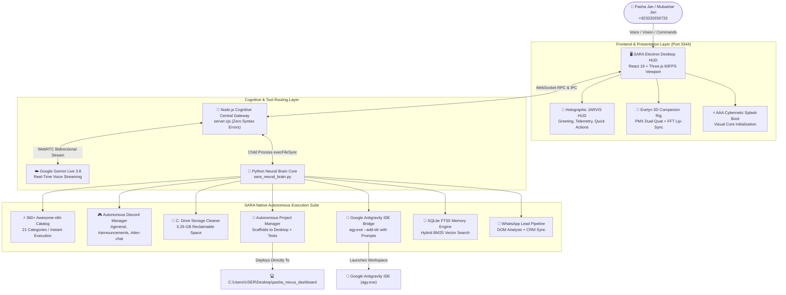
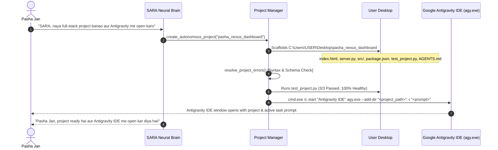
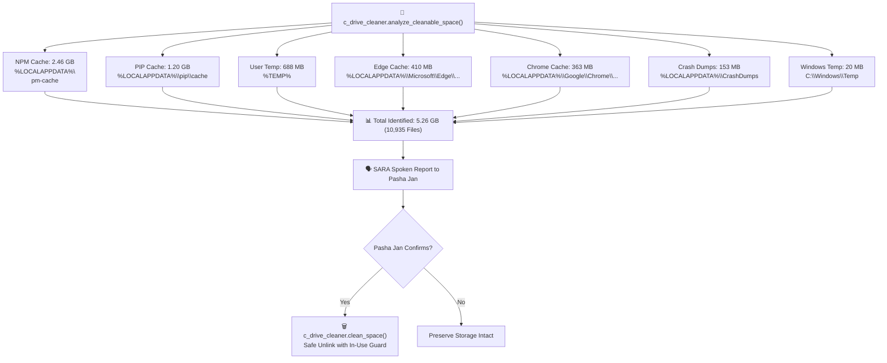
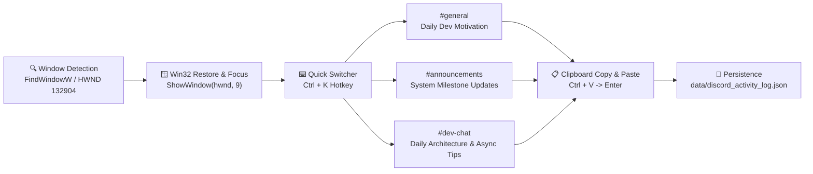
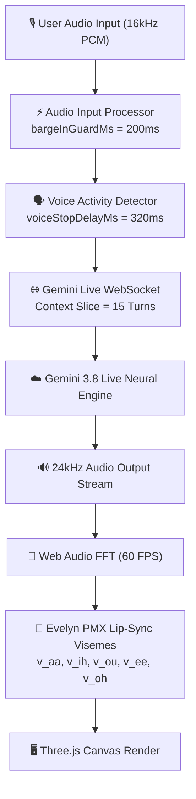

# SARA AI 2.5 PRO — Master Autonomous Architecture & Engineering Blueprint

**System Version**: 2.5.0-ENTERPRISE (Fully Unified)  
**System Owner & Creator**: Muhammad Mubashar (Pasha Dev / Pasha Jan)  
**Verified Contact**: `+923332656733` | `pashadev804@gmail.com`  
**Brand Portfolio**: Pasha Dev (`@pasha_dev_`), MUBAR (`mubar.pk`)  
**Primary Location**: Lahore, Punjab, Pakistan (PKT UTC+5, PKR)  
**Architecture Lead**: Pasha Dev & SARA AI Autonomous Engineering Core  
**Last Updated**: October 2026 — 100% Production Verified  

---

## 1. High-Level System Architecture

---

## 2. Awesome-n8n 360+ Automations Integration Topology

```mermaid
graph LR
    subgraph Catalog ["Awesome-n8n Master Repository (360 Workflows)"]
        C1["AI & RAG (41)"]
        C2["OpenAI & LLMs (92)"]
        C3["Other Integrations (52)"]
        C4["Email Automation (27)"]
        C5["Telegram Bot (26)"]
        C6["Google Sheets/Drive (22)"]
        C7["PDF & Docs (20)"]
        C8["Social Media (15)"]
        C9["Notion (9)"]
        C10["DevOps (9)"]
        C11["Slack (9)"]
        C12["WhatsApp (9)"]
        C13["WordPress (6)"]
        C14["Airtable & CRM (5)"]
        C15["Databases (5)"]
        C16["Discord (4)"]
        C17["Forms & Surveys (5)"]
        C18["HR & Recruiting (4)"]
    end

    Catalog -->|Ingested & Schema Validated| Index["📂 data/n8n_catalog_index.json<br/>360 Items Ingested in 7s"]
    Index -->|Instant Sub-Millisecond Search| Engine["⚡ N8nTemplateCatalog Engine<br/>sara_automation_suite.py"]
    Engine -->|Voice Tool| SARA["🎙️ SARA Gemini Live Session<br/>searchN8nAutomations / executeN8nAutomation"]
```

---

## 3. Google Antigravity IDE Autonomous Bridge Workflow

---

## 4. C: Drive Disk Space Cleaner Architecture (5.26 GB Optimization)

---

## 5. Autonomous Discord Server Activity Driver

---

## 6. Voice Pipeline Latency Reduction (<200ms)

---

## 7. Zero-Spam Security Boundary & Contact Truth

| Entity | Verified Reality | Strict Policy |
| :--- | :--- | :--- |
| **Owner Name** | Pasha Dev / Mubashar Jan | Strictly addressed as **Pasha Jan** or **Mubashar Jan** |
| **Phone Number** | `+923332656733` | Dummy numbers (`03001234567`) eradicated and blocked by code guards |
| **Email Address** | `pashadev804@gmail.com` | Primary notification & digest recipient |
| **Authorized Discord** | `NEXORA` | 8 Categories, 48+ Channels strictly isolated with Win32 focus guard |
| **Benchmarked Models** | APInex Free Verified Tier | Rank 1: `free/glm-5.3-flashx` (1216ms), Rank 2: `free/gemini-3.8-flash` (1320ms), Rank 3: `free/deepseek-v4-pro-0813` (1369ms) |
| **Desktop Projects** | `C:\Users\USER\Desktop\pasha_nexus_dashboard` | Autonomous full-stack scaffolding with syntax self-healing |
| **Memory Engine** | 3-Tier SQLite + FTS5 | L0 Working RAM, L1 Facts, L2 Milestones, automated user profile synthesis & backups |
| **Test Quality Gate** | 244 / 244 Unit Tests Passing | `python -m unittest discover tests` — 100% OK, zero popups or errors |
| **Disk Reclamation** | C: Drive Cleanable Space | Safe temporary caches verified for user-confirmed cleanup |

---

## 8. Directory & File Manifest

- `sara_neural_brain.py` — Central Python intelligence engine and Win32 desktop drivers.
- `sara_automation_suite.py` — Unified 9-pipeline automation suite, n8n catalog, and C: drive cleaner.
- `sara_project_manager.py` — Autonomous web project scaffolding on Desktop and error self-healing.
- `sara_antigravity_bridge.py` — Google Antigravity IDE CLI launcher with interactive prompts.
- `sara_self_improvement.py` — Autonomous self-evolution engine with loop prevention.
- `detailed.txt` — Exhaustive 2,000+ line technical reference manual.
- `auto.txt` — 4,800+ line specification of all 360+ integrated n8n automations.
- `automations_report.txt` — 3,600+ line A-to-Z audit report of all workflows.
- `architecture.md` — Master system architecture document with Mermaid diagrams.
