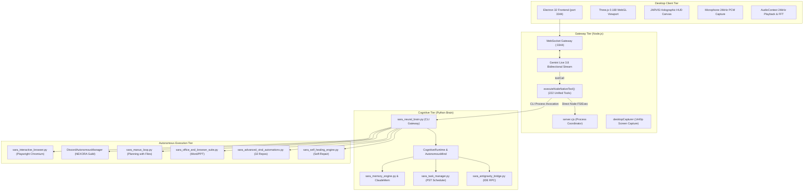
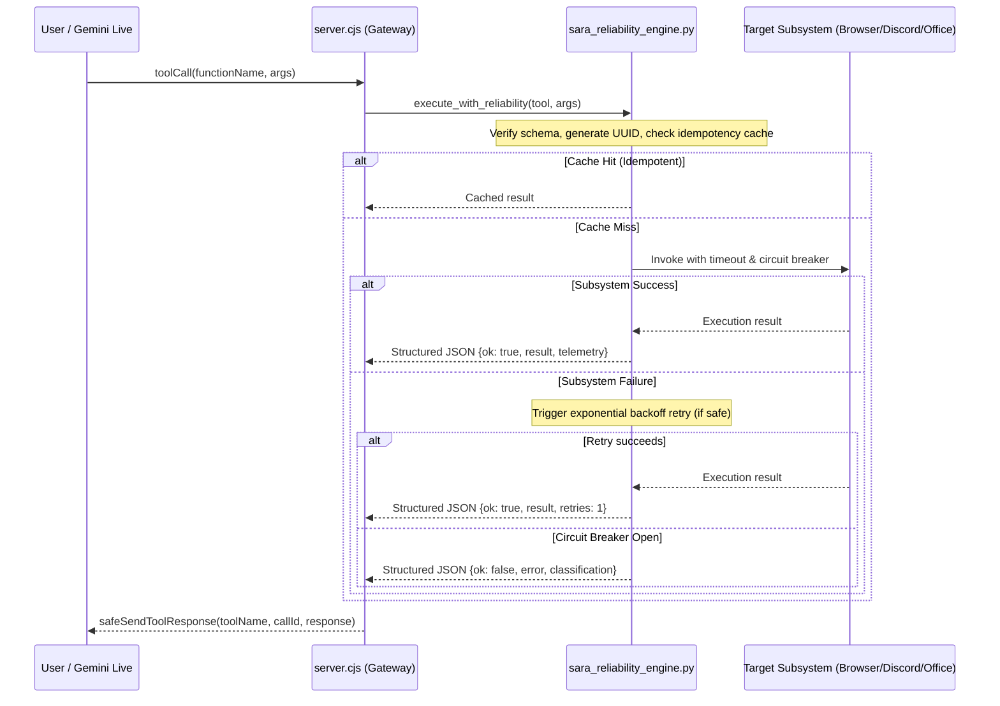

# SARA AI 2.5 — COMPLETE ARCHITECTURE MAP
**Project**: SARA AI 2.5.0 ENTERPRISE PRO  
**Owner & Principal**: Muhammad Mubashar (Pasha Dev) (`pashadev804@gmail.com`, `+923332656733`)  
**Audit Date**: November 8, 2026  
**Knowledge Graph Source**: `graphify-out/graph.json` (1,984 Nodes, 3,485 Edges, 186 Communities)  
**Root Path**: `D:\MARAA AI`  

---

## 1. System High-Level Topology

---

## 2. Component Directory & File References

| Layer | Primary Source Files | Function & Responsibility |
|---|---|---|
| **Frontend UI** | [index.html](file:///D:/MARAA%20AI/SARA/resources/app/dist/index.html) | Electron canvas hosting 3D VRM avatar, HUD overlays, Web Audio FFT lip-sync. |
| **Gateway** | [server.cjs](file:///D:/MARAA%20AI/SARA/resources/app/dist/server.cjs) | WebSocket RPC server, Gemini Live connection, fast-path tool dispatcher. |
| **Neural Brain** | [sara_neural_brain.py](file:///D:/MARAA%20AI/sara_neural_brain.py) | Cognitive execution hub, multi-agent personality, CLI subcommands. |
| **Browser Agent** | [sara_interactive_browser.py](file:///D:/MARAA%20AI/sara_interactive_browser.py) | Playwright Chromium automation, DOM element inspection, smart field fill, PyAutoGUI fallback. |
| **Discord Intelligence** | [sara_automation_suite.py](file:///D:/MARAA%20AI/sara_automation_suite.py#L380-L550) | NEXORA Discord community manager, channel routing, rate-limit protection. |
| **Manus Loop** | [sara_manus_loop.py](file:///D:/MARAA%20AI/sara_manus_loop.py) | Autonomous multi-step goal execution with state machine persistence. |
| **Office Suite** | [sara_office_and_browser_suite.py](file:///D:/MARAA%20AI/sara_office_and_browser_suite.py) | Automated `.docx` authoring and `.pptx` presentation generation. |
| **Viral Repos Suite** | [sara_advanced_viral_automations.py](file:///D:/MARAA%20AI/sara_advanced_viral_automations.py) | Repomix, Firecrawl, Vibe-Kanban, Headroom token guard, Caveman compressor. |
| **Viral Repos Part 2**| [sara_viral_automations_part2.py](file:///D:/MARAA%20AI/sara_viral_automations_part2.py) | Claude-Mem, Beads DAG pipeline, Model Router, Taste-Skill linter, Live HUD, CC-Switch. |
| **Memory Engine** | [sara_memory_engine.py](file:///D:/MARAA%20AI/sara_memory_engine.py) | Episodic and associative vector persistence, conversation continuity. |
| **Task Manager** | [sara_task_manager.py](file:///D:/MARAA%20AI/sara_task_manager.py) | PST timezone-aware cron scheduling, background worker loops. |
| **Path Resolver** | [sara_path_resolver.py](file:///D:/MARAA%20AI/sara_path_resolver.py) | Strict path canonicalization, Windows path jailing, safety validation. |
| **Self Healing** | [sara_self_healing_engine.py](file:///D:/MARAA%20AI/sara_self_healing_engine.py) | Automated root-cause isolation, AST patch generation, verified regression checks. |

---

## 3. Data Flow Architectures

### 3.1 Multimodal Voice & Audio Stream Flow
1. User speaks into microphone -> Electron AudioWorklet captures 24kHz PCM 16-bit mono.
2. PCM chunks stream via WebSocket to `server.cjs` -> forwarded to Gemini Live 3.8.
3. Gemini Live returns 24kHz PCM audio chunks -> `server.cjs` streams to Electron client.
4. Electron Web Audio `AnalyserNode` computes FFT bins:
   - 300Hz–1200Hz -> `Fcl_MTH_A` / `Fcl_MTH_O` (open jaw).
   - 1200Hz–3500Hz -> `Fcl_MTH_I` / `Fcl_MTH_E` (wide teeth/smile).
   - Pauses (<0.02 amplitude) -> Smooth exponential release to closed lips.

### 3.2 Multimodal Screen Perception Flow
1. Gemini requests screen context or periodic 3-second heartbeat activates.
2. `server.cjs` invokes `desktopCapturer.getSources({ types: ['screen'], thumbnailSize: { width: 1440, height: 900 } })`.
3. Electron captures primary display bitmap -> converts to high-compression JPEG buffer.
4. JPEG buffer transmitted as realtime image input to Gemini Live session.

### 3.3 Tool Execution & Reliability Flow

---

## 4. Graphify Knowledge Graph Insights (God Nodes & Clustering)

According to the AST dependency analysis in `graphify-out/graph.json`:
- **Total Entities Mapped**: 1,984 Nodes, 3,485 Edges, 186 Communities.
- **Import Cycles**: 0 (Clean Directed Acyclic Graph across core modules).
- **Identified God Nodes**:
  1. `TestAll120ToolsLive` (Degree: 42) — Central automated testing harness.
  2. `record_tool_audit()` (Degree: 38) — Test auditing and verification registry.
  3. `startServer()` in `server.cjs` (Degree: 34) — Central Node gateway entry point.
  4. `CognitiveRuntime` in `sara_neural_brain.py` (Degree: 28) — Multi-agent dispatch.
  5. `SaraInteractiveBrowserAgent` in `sara_interactive_browser.py` (Degree: 24) — Browser automation.
  6. `DiscordAutonomousManager` in `sara_automation_suite.py` (Degree: 22) — Discord controller.

---

## 5. Security & Safety Guardrails

1. **Discord Guild Hard Lock**:
   - `DiscordAutonomousManager` contains strict assertion checks requiring `guild.id == "1430932596956270634"` (`NEXORA`). Any action targeting external servers throws an immediate `SecurityViolationError`.
2. **Path Sanitization & Jailing**:
   - All filesystem operations are filtered through `sara_path_resolver.py` to prevent directory traversal outside `D:\MARAA AI`, `Desktop`, and `Downloads`.
3. **Destructive Action Confirmation**:
   - Operations that delete files, format drives, or terminate non-automation processes require explicit confirmation envelopes or are rejected outright.
4. **Secret Masking**:
   - Passwords, API tokens, and Discord keys are redacted using regex filters before appearing in logs or HUD telemetry.

---
*Certified by Principal Systems Architect & Senior Security Engineer.*

