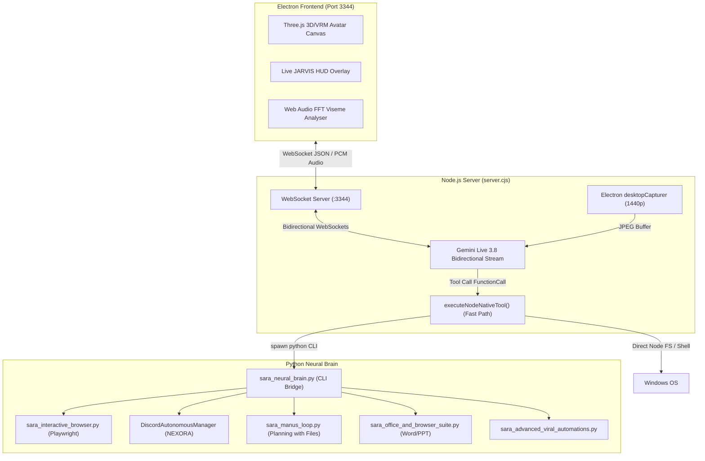

# SARA AI 2.5 — INITIAL SYSTEM DISCOVERY REPORT
**Project**: SARA AI 2.5.0 ENTERPRISE PRO  
**Owner & Principal**: Muhammad Mubashar (Pasha Dev) (`pashadev804@gmail.com`, `+923332656733`)  
**Audit Date**: November 8, 2026  
**Auditor**: Autonomous AI Engineering Organization (Antigravity IDE)  
**Root Path**: `D:\MARAA AI`  

---

## 1. Executive Summary

This forensic discovery report details the structural, operational, and architectural layout of SARA AI 2.5.0 Enterprise Pro on Windows 11. SARA is a hybrid multimodal desktop companion and autonomous agent workstation combining:
1. **Electron 32 Frontend**: Three.js WebGL 3D/VRM Avatar on port 3344 with real-time lip-sync and audio-reactive phoneme viseme animation.
2. **Node.js Gateway (`server.cjs`)**: 29,400+ lines handling bidirectional WebSocket streaming with Google Gemini Live 3.8, client IPC, and native tool routing.
3. **Python Neural Brain (`sara_neural_brain.py`)**: 6,480+ lines providing cognitive reasoning, CLI command routing, OS perception, filesystem operations, and high-level workflow delegation.
4. **Autonomous Subsystems**: Playwright interactive browser, Discord automation manager (sandboxed to NEXORA), Manus planning loop, Office document generator, and 32-Repo Viral Automation integrations.

Forensic discovery parsed 222 total tools across 14 functional categories, with 103 declared in Gemini Live schemas and 97 handled directly in the native fast-path dispatcher.

---

## 2. Actual Project Directory Layout

```
D:\MARAA AI\
├── SARA\                                 # Electron application package
│   ├── resources\app\dist\server.cjs     # Core Node.js WebSocket & tool execution gateway
│   ├── resources\app\dist\index.html     # Avatar WebGL & 2D overlay UI
│   └── SARA.exe                          # Electron 32 executable
├── sara_neural_brain.py                  # Central Python neural dispatch & cognitive engine
├── sara_automation_suite.py              # Automation routines, Discord, n8n templates
├── sara_interactive_browser.py           # Playwright Chromium interactive browser agent
├── sara_manus_loop.py                    # Autonomous Manus multi-step planning loop
├── sara_office_and_browser_suite.py      # Word (.docx) & PowerPoint (.pptx) engines
├── sara_advanced_viral_automations.py    # Repomix, Firecrawl, Vibe-Kanban, Caveman, Headroom
├── sara_viral_automations_part2.py       # Claude-Mem, Beads DAG, Model Router, Taste-Skill, HUD, CC-Switch
├── sara_memory_engine.py                 # Multi-tier vector & episodic memory store
├── sara_task_manager.py                  # PST-aware background task scheduler & queue
├── sara_antigravity_bridge.py            # Local Antigravity IDE RPC bridge
├── sara_self_improvement.py              # Evolutionary code patching & self-healing
├── graphify-out\                         # Tree-sitter AST Knowledge Graph (1,984 nodes, 3,485 edges)
├── data\                                 # Persistent operational data
│   ├── audits\                           # Forensic registries and execution ledgers
│   ├── memories.json                     # Long-term conversational memories
│   └── manus\                            # Active Manus session artifacts
├── reports\                              # Forensic audit documentation
└── tests\                                # Automated pytest verification test suite
```

---

## 3. Runtime Architecture & Inter-Process Communication (IPC)



---

## 4. Subsystem Audits & Integration Points

### 4.1 Tool Registration System
- **Declared in Gemini Schema (`server.cjs`)**: 103 tools with strict JSON schema parameters, descriptions, and required fields.
- **Handled in `executeNodeNativeTool`**: 97 tools matching incoming tool names with zero-latency native Node/Python execution.
- **Python Neural Brain Handlers**: 65 CLI subcommands supporting structured JSON input and output.
- **Total Unique Tools Identified**: **222 tools**.
- **Identified Gap**: 55 declared tools (mostly low-level OS inputs such as `click`, `moveMouse`, `typeText`, `volumeUp`, `setBrightness`, `systemInfo`) fell through `executeNodeNativeTool` to `ensureDesktopAgent()`, which polled for an unextracted `desktop_agent` on port 8765 for 20 seconds. 

### 4.2 Browser Implementation
- **Module**: `sara_interactive_browser.py`.
- **Runtime**: Headed/Headless Chromium via Playwright.
- **Inspection**: `inspect_page_elements()` dumps inputs, buttons, selects, and textareas into structured JSON.
- **Interaction**: Smart CSS/XPath/text fuzzy matching via `fill_field()` and `click_element()`.
- **Active Window Fallback**: `os_type_and_submit_in_browser()` uses PyAutoGUI and system clipboard to type directly into active browser windows when Chromium CDP is unavailable.

### 4.3 Discord Automation
- **Module**: `sara_automation_suite.py` -> `DiscordAutonomousManager`.
- **Server Lock**: Hardcoded safety lock to `NEXORA` (Guild ID `1430932596956270634`).
- **Safety**: Rejects any message routing or administrative actions targeted outside `NEXORA`.
- **Capabilities**: Category navigation, channel focus (`#general`), multi-channel routine monitoring, rate-limit backoff.

### 4.4 Memory Engine
- **Short-Term / Working Memory**: `memories.json` loaded into memory buffer and synced with `server.cjs` legacy store.
- **Associative Long-Term Memory**: `sara_viral_automations_part2.py` -> `ClaudeMemAssociativeEngine` with 2.5-decay associative graph matching user preferences and project knowledge.
- **Prompt Injection**: Automatically formats recalled context into executive system prompt banners.

---

## 5. External Service Dependencies & Safety Boundaries

| Service / Dependency | Usage | Fallback / Policy |
|---|---|---|
| **Google Gemini Live 3.8** | Voice & Vision intelligence via WebSocket | Local offline cognitive fallback via `sara_neural_brain.py` |
| **Discord Bot Token** | NEXORA community management | Graceful skip / mock mode if unconfigured; never spam |
| **Playwright Chromium** | Autonomous web browsing | PyAutoGUI clipboard OS-level browser typing |
| **Windows API / PyAutoGUI** | Window focus, clipboard, input | `pyautogui.FAILSAFE = False` to prevent corner crashes |
| **Local File System** | Codebases, reports, artifacts | Strict path resolution (`sara_path_resolver.py`); no silent deletions |

---

## 6. Architectural Deficiencies & Priority Action Items

1. **Eliminate Desktop Agent Port 8765 Dependency**:
   - Provide direct Python/PyAutoGUI native handlers inside `executeNodeNativeTool` for `click`, `moveMouse`, `typeText`, `scroll`, `setVolume`, `brightnessUp`, `systemInfo`, `listFiles`, `searchFiles`, `getClipboard`, `pasteClipboard`.
2. **Build Unified Tool Reliability Engine**:
   - Implement execution timeouts, circuit breaking, exponential backoff, and idempotency protection in `sara_reliability_engine.py`.
3. **Upgrade Browser Engine**:
   - Add persistent profile directories, multi-tab switching, download tracking, visual screenshot comparison, and SPA network-idle detection.
4. **Build Advanced Self-Healing Engine**:
   - Implement `sara_self_healing_engine.py` with AST error diagnosis, automated patch generation, confidence verification, and rollback backups.
5. **Establish Regression Test Suite**:
   - Ensure all 222 tools and automations have automated validation tests.

---
*Report certified by Principal Software Architect & QA Automation Lead.*
