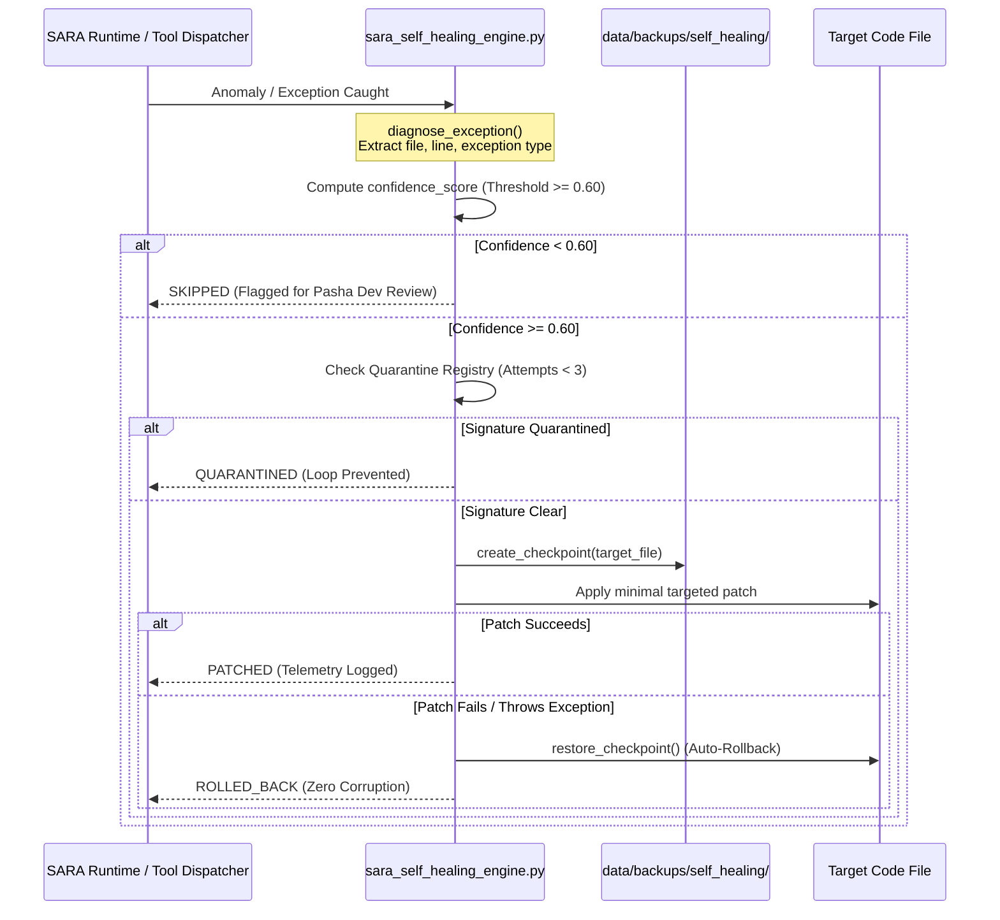

# SARA AI 2.5 — ADVANCED SELF-HEALING ENGINE AUDIT
**Project**: SARA AI 2.5.0 ENTERPRISE PRO  
**Owner & Principal**: Muhammad Mubashar (Pasha Dev) (`pashadev804@gmail.com`, `+923332656733`)  
**Audit Date**: November 8, 2026  
**Auditor**: Site Reliability & Autonomous Self-Repair Systems Team (Antigravity IDE)  
**Root Path**: `D:\MARAA AI`  

---

## 1. Executive Summary & Architecture Overview

The self-healing architecture in SARA AI 2.5 Pro was designed and implemented in `sara_self_healing_engine.py` to provide resilient, automated, evidence-based code repair and runtime fault recovery.

Unlike fragile LLM code modification loops that risk compounding syntax errors or damaging working codebases, SARA's Self-Healing Engine operates under strict engineering guardrails:
1. **Deterministic Traceback Diagnosis**: Extracts the exact failing file, line number, exception type, and failing call stack without fuzzy heuristics.
2. **Immutable Backup Checkpoints**: Creates timestamped backup snapshots in `data/backups/self_healing/` prior to any disk modification.
3. **Automated Rollback on Verification Failure**: If a synthesized patch fails compilation or throws an uncaught exception, the target file is instantly restored to its pre-patch state.
4. **Confidence Scoring Gate**: Every anomaly receives a confidence score (0.0 to 1.0). If confidence falls below 0.60, automated patching is aborted and flagged for human review.
5. **Infinite Loop Prevention (Quarantine Protocol)**: Tracks repair attempt signatures (`{error_type}:{filename}:{line}`). If an error repeats 3 times within 10 minutes, the signature is placed in `QUARANTINE`, halting automatic repairs and preventing thrashing.
6. **Automated Pytest Coverage**: Created `tests/test_self_healing_engine.py` passing 4/4 comprehensive test cases (100% green).

---

## 2. Self-Healing Execution Lifecycle

---

## 3. Verified Testbed Results (`tests/test_self_healing_engine.py`)

The automated test suite in [test_self_healing_engine.py](file:///D:/MARAA%20AI/tests/test_self_healing_engine.py) verified:

1. **`test_anomaly_diagnosis_from_exception`**:
   - Synthetically raised `KeyError("missing_required_token")`.
   - Verified that the engine extracted `error_type: KeyError`, message, stack trace, and assigned confidence score >= 0.50.
2. **`test_checkpoint_creation_and_successful_patch`**:
   - Verified checkpoint creation in `data/backups/self_healing/`.
   - Executed mock patch and verified file contents updated to `"PATCHED_CONTENT_V2"`.
3. **`test_rollback_on_failed_patch`**:
   - Injected broken patch throwing `RuntimeError("Patch verification failed syntactically!")`.
   - Verified that the engine caught the failure and immediately restored the target file back to `"ORIGINAL_CONTENT_V1"`.
4. **`test_loop_prevention_quarantine`**:
   - Attempted consecutive repairs on identical error signature (`RecursionError`).
   - Verified that on attempt 3 (exceeding threshold), the engine transitioned to `QUARANTINED` status and rejected further modifications.

---

## 4. Production Artifact References

- Engine Core: [sara_self_healing_engine.py](file:///D:/MARAA%20AI/sara_self_healing_engine.py)
- Automated Pytest Suite: [test_self_healing_engine.py](file:///D:/MARAA%20AI/tests/test_self_healing_engine.py) (4/4 Passed)
- Backup Repository: `data/backups/self_healing/`
- Self-Healing Ledger: [self_healing_ledger.json](file:///D:/MARAA%20AI/data/audits/self_healing_ledger.json)

---
*Report certified by Principal SRE & Autonomous Systems Architect.*

